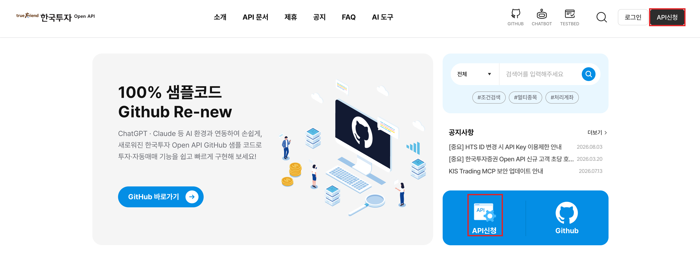
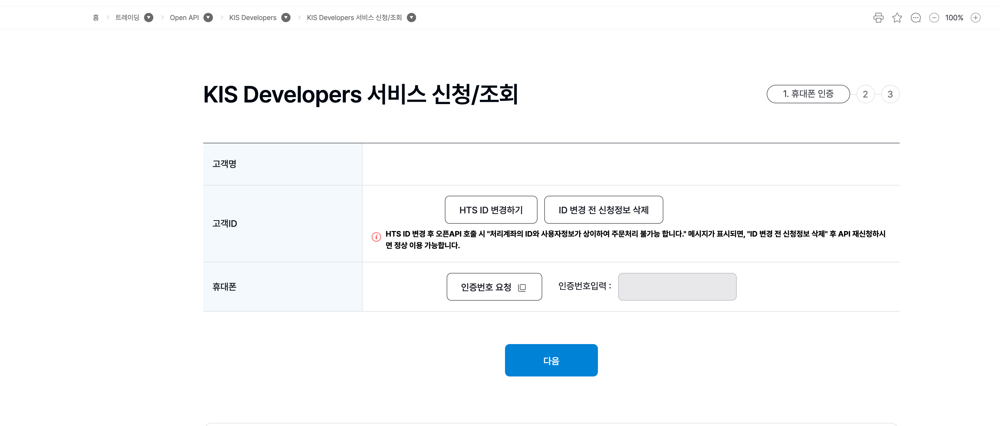
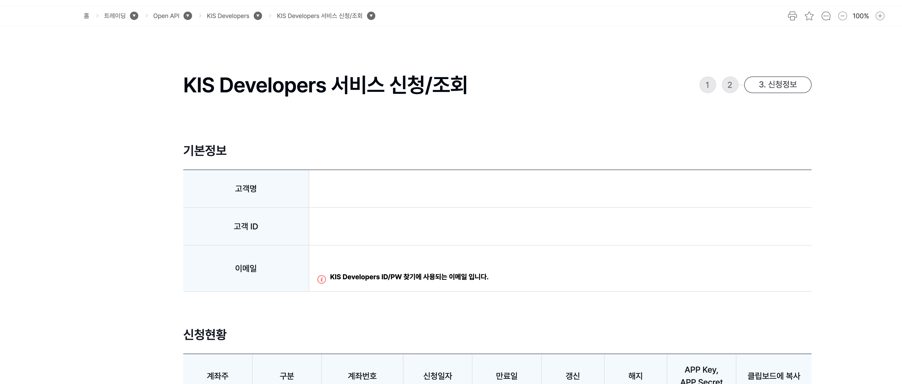
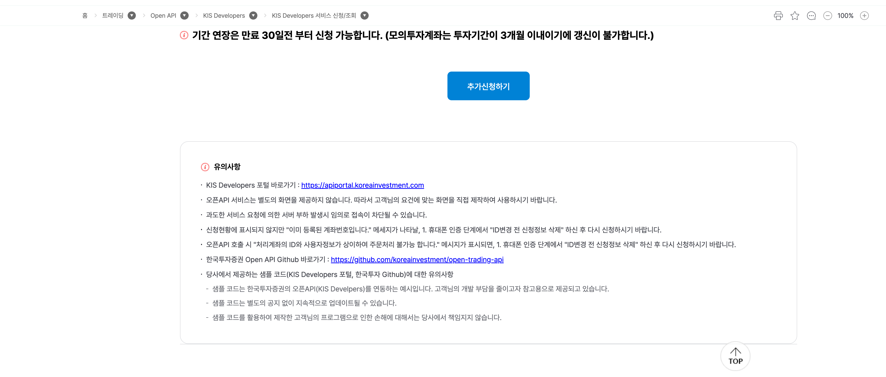
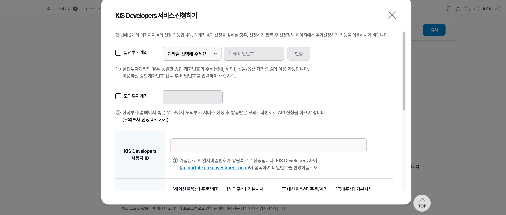
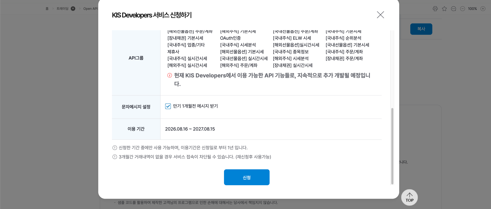
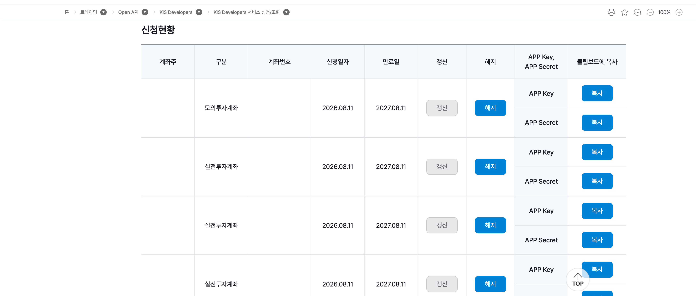

# 앱키 발급받기

한국투자증권 홈페이지에서 Open API 앱키(**APP Key**)·앱시크릿(**APP Secret**)을 발급받는 과정을
캡처 화면과 함께 따라합니다. 화면의 메뉴·기간·신청 조건은 실제 신청 시 다시 확인하세요. 발급받은 두 값은 [자격증명과 프로필](configuration.md)에서 저장합니다.

::: {.callout-tip}
처음이라면 **모의투자용부터** 발급받아 연습하는 것을 권장합니다.
(실전용과 모의투자용 앱키는 **따로** 발급됩니다.)

**모의투자용 앱키**는 발급 전에 한국투자증권에서 **모의투자 참가신청**을 먼저 해 **모의계좌**가 있어야
합니다(신청 화면에서 그 모의계좌번호를 입력). 실전용은 실계좌로 바로 발급합니다.
:::

## 준비

- 한국투자증권 **실계좌**가 있어야 합니다(없으면 먼저 개설). 그리고 HTS/MTS 등에서 **API 서비스
  신청(사용 동의)**을 해야 합니다.
- 신청 화면으로 가는 방법은 두 가지입니다:
  - **KIS 개발자센터** <https://apiportal.koreainvestment.com/intro> 에서 오른쪽 맨 위의 검정색
    **API 신청** 버튼(또는 본문의 파란색 **API 신청** 버튼)을 누릅니다.
  - 또는 홈페이지 로그인 후 **트레이딩 > Open API > KIS Developers > KIS Developers 서비스 신청/조회**
    로 이동합니다.

## 휴대폰 인증

본인 휴대폰으로 인증번호를 받아 인증합니다.

## 신청정보 확인

기본정보(고객명·고객 ID·이메일)를 확인합니다.

같은 페이지 아래쪽의 **추가신청하기**(최초라면 **신청하기**) 버튼으로 계좌에 API 이용을 신청합니다
(유의사항도 함께 안내됩니다).

캡처된 유의사항은 모의 신청 기간을 3개월·연장 불가로 안내합니다. 일반 1년 안내와 혼동하지 말고
현재 신청 유형의 기간을 확인하세요. 연장 대상의 갱신 버튼은 종료 예정일 30일 전부터 활성화된다고
[공식 FAQ](https://apiportal.koreainvestment.com/community/10000000-0000-0011-0000-000000000002/post/c8c8c9b2-8f19-4282-ad40-ef5b83205ae2)가 안내합니다.

## API 서비스 신청하기

앱키·앱시크릿을 발급받으려면 계좌에 API 이용을 신청해야 합니다. 위 버튼을 누르면 뜨는 창에서,
실전투자계좌는 종합계좌를 고르고 계좌 비밀번호로 인증하며, 모의투자계좌는 발급받은 모의계좌번호를
입력합니다. **KIS Developers 사용자 ID**도 함께 정합니다.

캡처의 계좌 수 제한은 **한 번의 신청에 최대 2계좌**라는 안내이며, 전체 등록 계좌의 총한도를
뜻하지 않습니다. 추가 계좌는 추가 신청 안내를 확인하세요.

사용할 **API 그룹**을 선택하고 **신청**을 누릅니다.

## 신청현황에서 APP Key · APP Secret 복사

신청이 완료되면 **신청현황** 목록에 계좌가 나타납니다. 각 계좌 행에서 **APP Key**와 **APP Secret**을
각각 **복사** 버튼으로 복사합니다. 이 두 값이 세션을 여는 자격증명입니다.

::: {.callout-warning}
APP Key·APP Secret은 남에게 보이거나 공개 저장소(GitHub)에 올라가지 않도록 조심해 주세요.
:::

## 다음 — 자격증명 저장

복사한 APP Key·APP Secret(과 계좌번호)을 [자격증명과 프로필](configuration.md)의
`KISConfig(...).save()` 로 저장하면, 이후 `KISClient(profile=...)` 한 줄로 세션이 열립니다.
